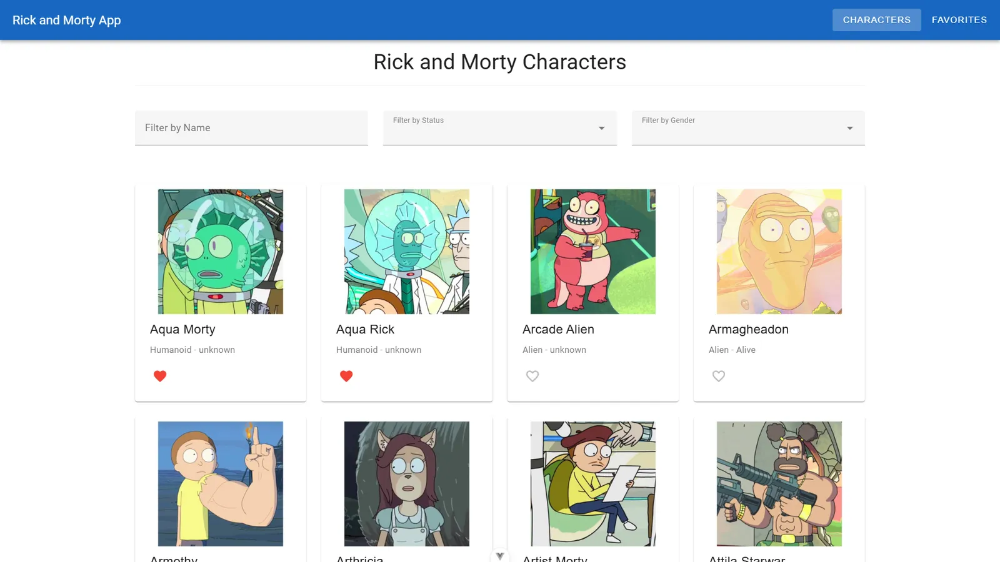
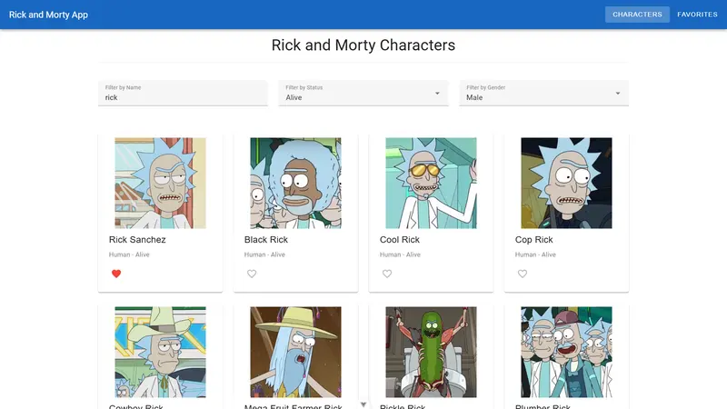
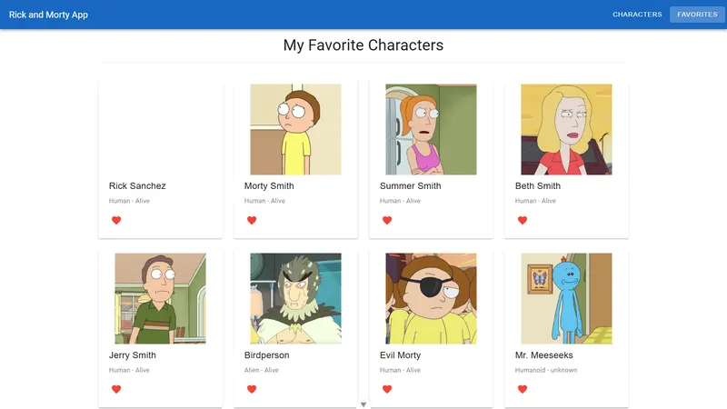
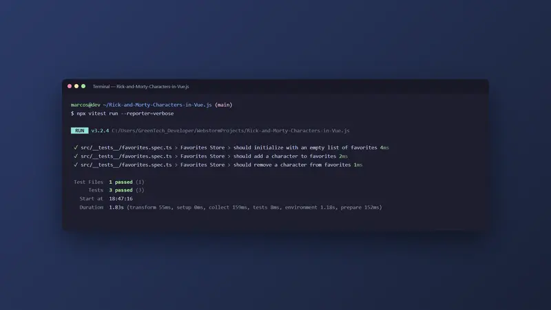

# Catálogo de Personagens Rick and Morty em Vue.js

Arquitetura modular em Vue 3 com Pinia, filtros, favoritos e testes.

<p align="center">
  
</p>

---

## Sumário

- [Visão geral](#visão-geral)
- [Telas](#telas)
- [Arquitetura](#arquitetura)
- [Stack e versões](#stack-e-versões)
- [Estrutura do projeto](#estrutura-do-projeto)
- [Primeiros passos](#primeiros-passos)
- [Scripts](#scripts)
- [Autor](#autor)

---

## Visão geral

Lista os personagens da série a partir da API pública, com filtros, paginação e favoritos salvos no navegador. Arquitetura modular (camada de API, composables para filtros e paginação, Pinia para estado global) e testes unitários.

Principais funcionalidades:

- Filtros por nome, status e gênero
- Paginação e favoritos persistidos
- Composables e Pinia para estado global
- Testes unitários com Vitest

Concluído em 09/2025.

---

## Telas

Todas as telas usam dados fictícios.

<table>
  <tr>
    <td width="50%"><br><sub>Filtros aplicados por nome, status e gênero</sub></td>
    <td width="50%"><br><sub>Tela de favoritos</sub></td>
  </tr>
  <tr>
    <td width="50%"><br><sub>Resultado dos testes do Vitest no terminal</sub></td>
  </tr>
</table>

---

## Arquitetura

A arquitetura do projeto foi projetada para ser modular, seguindo o princípio de separação de responsabilidades.

* **`src/api`**: Camada de consumo da API. Todas as requisições HTTP são centralizadas aqui, tornando o projeto mais fácil de manter caso a API mude.
* **`src/composables`**: Encapsula a lógica reutilizável da aplicação, como a gestão de filtros e paginação dos personagens. Isso mantém os componentes da interface (UI) limpos e focados apenas na renderização.
* **`src/stores`**: O **Pinia** é usado para o gerenciamento de estado global, como a lista de personagens favoritos. A persistência dos favoritos é feita via `localStorage`.
* **`src/views`**: Contém os componentes de página (`CharacterList`, `CharacterDetails`, `FavoritesList`). Cada `view` é responsável por uma tela específica da aplicação.
* **`src/types`**: Define todas as interfaces e tipos de dados usados no projeto, garantindo a tipagem segura de ponta a ponta.

---

---

## Stack e versões

| Categoria | Tecnologia | Versão |
| --- | --- | --- |
| Linguagem | TypeScript | 5.8 |
| UI | Vue | 3.5 |
| Build | Vite | 7.0 |
| Rotas | Vue Router | 4.5 |
| Componentes | Vuetify | 3.9 |
| HTTP | Axios | 1.11 |
| Estado | Pinia | 3.0 |
| Testes | Vitest | 3.2 |
| Qualidade | ESLint + Prettier | 9.35 / 3.6 |

As versões exatas estão no `package.json`.

---

## Estrutura do projeto

```
src/
  __tests__/
    favorites.spec.ts
  api/
    character.ts
  composables/
    useCharacters.ts
  router/
    index.ts
  stores/
    favorites.ts
  types/
    index.ts
  views/
    CharacterDetails.vue
    CharacterList.vue
    FavoritesList.vue
  App.vue
  main.ts
```

---

## Primeiros passos

### Pré-requisitos

- Node.js 18 ou mais recente
- npm

### Instalação

```bash
git clone https://github.com/marcospsdev/Rick-and-Morty-Characters-in-Vue.js.git
cd Rick-and-Morty-Characters-in-Vue.js
npm install
npm run dev               # http://localhost:5173
```

---

## Scripts

| Comando | Descrição |
| --- | --- |
| `npm run dev` | Servidor de desenvolvimento (Vite) |
| `npm run build` | Typecheck e build de produção em `dist/` |
| `npm run preview` | Serve o build de produção localmente |
| `npm run test:unit` | Testes unitários (Vitest) |
| `npm run build-only` | Build de produção sem typecheck |
| `npm run type-check` | Checagem de tipos (vue-tsc) |
| `npm run lint` | Analisa o código com o ESLint |
| `npm run format` | Formata o código com o Prettier |
| `npm test` | Testes unitários |

---

## Autor

**Marcos Paulo** · Desenvolvedor Full-Stack

- LinkedIn: [in/marcospsdev](https://www.linkedin.com/in/marcospsdev)
- GitHub: [@marcospsdev](https://github.com/marcospsdev)
